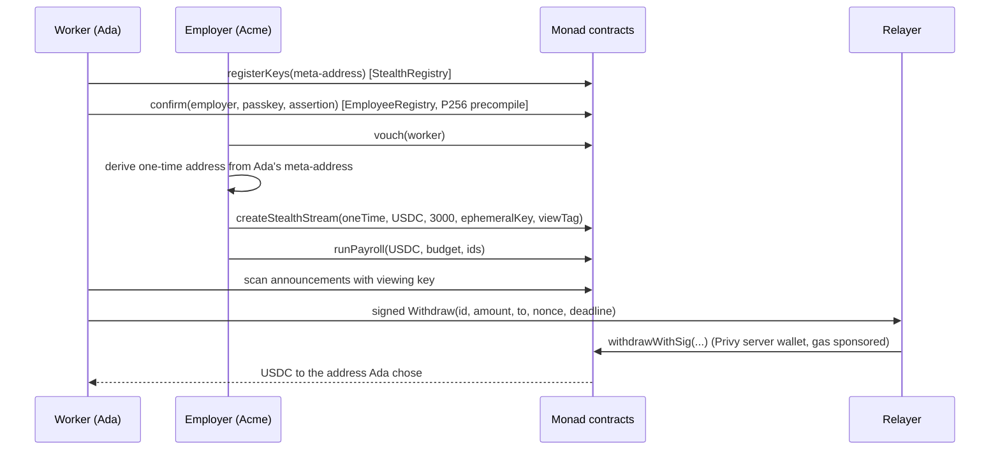

# Veil

> Salaries on Monad stream to one-time addresses, so nobody can tell whose pay is whose, and a worker can prove "I earn at least $2,500" to one landlord.

**Monad Metropolis** · Built on Monad, Privy, Chainlink CRE, Envio, Alchemy and passkeys

[Live app](https://veil-chi-eight.vercel.app) · [How it uses each sponsor](#how-veil-uses-each-sponsor) · [Deployed contracts](#deployments) · [Proof it ran](#proof-it-ran)

---

## The problem

Ada is paid 3,000 USDC a month. If her employer pays her onchain, her salary is public forever. Her coworkers, her landlord and any stranger with a block explorer can look up her wallet and see what she earns.

Then she applies for a flat. The landlord wants payslips, which show her exact salary and more. Sharing her wallet is worse, because it shows her whole financial history.

So companies keep payroll off-chain, and workers paid in crypto can't prove what they earn without over-sharing.

## How it works

Ada works for Acme Labs at 3,000 USDC a month. On testnet a "month" is 10 minutes, so you can watch it happen.

1. **Ada signs up with her email.** Privy gives her a wallet. She never sees a seed phrase or pays gas.
2. **She turns on private pay.** One signature derives her stealth keys, and she publishes a public "meta-address" in `StealthRegistry`.
3. **She confirms she works for Acme with Face ID.** Her passkey signs a challenge, and Monad's P256 precompile checks it onchain. Acme vouches for her from its console. With both, she is a "verified employee of Acme".
4. **Acme starts her stream.** The browser derives a fresh one-time address from Ada's meta-address, and the salary streams to that address. Onchain, the stream pays an address nobody has seen before, and nothing links it to Ada's wallet.
5. **Payroll runs every period, on its own.** A Chainlink CRE workflow checks Acme's streams each period and sends a signed report with the budget they need; Acme's receiver contract runs payroll with it, capped by a limit Acme set onchain. Acme can also run it by hand with a budget. Each stream gets `min(salary for the rest of the period, budget left)`, in table order. A 4,000 budget across two 3,000 streams gives 3,000 and 1,000. A stream only streams what was set aside, so pay never outruns the money.
6. **Ada finds her pay.** Her app fetches every stream announcement from Envio HyperSync and matches them against her viewing key, so it only reads the streams meant for her. Her balance ticks up every second, with no transactions.
7. **Ada withdraws, gas-free.** The one-time address has no MON, and funding it from her main wallet would link the two. So she signs the withdrawal, and Veil's relayer, a Privy server wallet with sponsored gas, sends it. The money goes wherever she chose.
8. **Ada proves her income.** Her landlord asks for at least 2,500 a month. Ada issues a credential that names the landlord and expires in 7 days. The landlord opens a link that shows whether her salary meets the threshold, that Acme Labs pays it, how long it has been active, and when the credential expires.

Salaries above an employer's limit wait for k-of-n approvers before they start. Auditors the employer appoints can read the books.



## What makes this different

- **Compared with public streaming payroll** (Sablier-style streams), where anyone who knows a worker's wallet can read their salary: Veil pays each stream to a fresh one-time address ([ERC-5564](https://eips.ethereum.org/EIPS/eip-5564)), so a block explorer shows a salary but not whose it is.
- **Compared with stealth payments alone:** a one-time address has no gas, and the usual fix is to fund it, which links it back to you. Veil's payee signs an EIP-712 withdrawal and a relayer sends it. The signature binds the amount, destination, nonce and deadline, so the relayer can't redirect the money.
- **Compared with "verified human" checks:** a landlord needs to know where you work more than that you're a unique person. Veil records both sides of employment: the employer vouches, and the worker confirms with a passkey that Monad's P256 precompile checks onchain.
- **Compared with payslips:** a credential goes to one named verifier, expires, and can be revoked. It answers "at least $X?" with yes or no from the live stream, so it can't be backdated or forged.

## Architecture

Permalinks point at commit [`078972f`](https://github.com/Kelechikizito/veil/tree/078972fb002e166149079d052312494888da3d75).

### VeilPayroll ([src/VeilPayroll.sol](https://github.com/Kelechikizito/veil/blob/078972fb002e166149079d052312494888da3d75/src/VeilPayroll.sol))

Orgs, per-token vaults and salary streams. Money flows vault → payroll → stream → payee.

- `createStealthStream` ([L227–L240](https://github.com/Kelechikizito/veil/blob/078972fb002e166149079d052312494888da3d75/src/VeilPayroll.sol#L227-L240)) pays a one-time address and emits an ERC-5564 `Announcement`, so the payee finds it by scanning.
- `_runPayroll` ([L375–L408](https://github.com/Kelechikizito/veil/blob/078972fb002e166149079d052312494888da3d75/src/VeilPayroll.sol#L375-L408)) splits a budget across streams, pro rata for the time left in the period. Finished periods move into `banked`, which stays withdrawable.
- `withdrawWithSig` ([L311–L324](https://github.com/Kelechikizito/veil/blob/078972fb002e166149079d052312494888da3d75/src/VeilPayroll.sol#L311-L324)) pays out on the payee's EIP-712 signature. Anyone can send it, so a stealth payee never needs gas.
- `setPayrollOperator` and `runPayrollFor` ([L290–L300](https://github.com/Kelechikizito/veil/blob/078972fb002e166149079d052312494888da3d75/src/VeilPayroll.sol#L290-L300)) let an employer allow an automation, such as a scheduled workflow, to run payroll for them. An operator can only move money from the vault into the employer's own active streams.
- Streaming is lazy: it is computed on each withdraw, so a stream costs nothing while it runs.

### VeilPayrollAutomation ([src/VeilPayrollAutomation.sol](src/VeilPayrollAutomation.sol)) and the CRE workflow ([cre/veil-payroll/main.ts](cre/veil-payroll/main.ts))

The employer deploys a receiver and allows it as payroll operator. A Chainlink CRE cron workflow fires 5 seconds into each pay period, reads the employer's streams on Monad, picks the Active ones not yet funded for this period, and computes what they need for the time left. It sends `abi.encode(budget, ids)` as a signed report through Chainlink's forwarder. `onReport` ([L121–L137](src/VeilPayrollAutomation.sol#L121-L137)) accepts only the configured forwarder (and, optionally, one workflow owner), caps the budget at the employer's onchain `maxBudget`, and calls `runPayrollFor`. The report can't reach another employer's streams or move money out: VeilPayroll checks every id.

### EmployeeRegistry ([src/EmployeeRegistry.sol](https://github.com/Kelechikizito/veil/blob/078972fb002e166149079d052312494888da3d75/src/EmployeeRegistry.sol)) and WebAuthn ([src/libraries/WebAuthn.sol](https://github.com/Kelechikizito/veil/blob/078972fb002e166149079d052312494888da3d75/src/libraries/WebAuthn.sol))

The employer calls `vouch` ([L59–L64](https://github.com/Kelechikizito/veil/blob/078972fb002e166149079d052312494888da3d75/src/EmployeeRegistry.sol#L59-L64)). The worker calls `confirm` ([L74–L88](https://github.com/Kelechikizito/veil/blob/078972fb002e166149079d052312494888da3d75/src/EmployeeRegistry.sol#L74-L88)) with a WebAuthn assertion over a per-pair challenge. `WebAuthn.verify` ([L64–L81](https://github.com/Kelechikizito/veil/blob/078972fb002e166149079d052312494888da3d75/src/libraries/WebAuthn.sol#L64-L81)) checks the client data and authenticator flags, then verifies the P256 signature through OpenZeppelin's `P256`, which calls the precompile at `0x100` on Monad. A worker is verified only when both sides have signed.

### StealthRegistry ([src/StealthRegistry.sol](https://github.com/Kelechikizito/veil/blob/078972fb002e166149079d052312494888da3d75/src/StealthRegistry.sol))

`registerKeys` ([L54–L60](https://github.com/Kelechikizito/veil/blob/078972fb002e166149079d052312494888da3d75/src/StealthRegistry.sol#L54-L60)) stores a worker's ERC-6538-style meta-address: two compressed secp256k1 keys, one for spending and one for viewing. The derivation is in [`frontend/lib/stealth.ts`](https://github.com/Kelechikizito/veil/blob/078972fb002e166149079d052312494888da3d75/frontend/lib/stealth.ts#L76-L97): the employer's browser makes the one-time address, and the worker's browser recognises it with the view tag and rebuilds its private key.

### IncomeCredential ([src/IncomeCredential.sol](https://github.com/Kelechikizito/veil/blob/078972fb002e166149079d052312494888da3d75/src/IncomeCredential.sol))

`_issue` ([L151–L185](https://github.com/Kelechikizito/veil/blob/078972fb002e166149079d052312494888da3d75/src/IncomeCredential.sol#L151-L185)) reads the live stream, records whether `monthly >= threshold`, the verifier, the expiry, how long the stream has been active, and whether the employment is verified. Stealth payees issue and revoke by signature through the relayer (`issueWithSig`, `revokeWithSig`).

### ApprovalPolicy, AuditRegistry, JoinRequests

- **[ApprovalPolicy](https://github.com/Kelechikizito/veil/blob/078972fb002e166149079d052312494888da3d75/src/ApprovalPolicy.sol)** holds each employer's k-of-n approvers and a monthly threshold per token. `needsApproval` ([L148–L152](https://github.com/Kelechikizito/veil/blob/078972fb002e166149079d052312494888da3d75/src/ApprovalPolicy.sol#L148-L152)) fails closed: a token with no threshold always needs approval.
- **[AuditRegistry](https://github.com/Kelechikizito/veil/blob/078972fb002e166149079d052312494888da3d75/src/AuditRegistry.sol)** lists each employer's auditors. The employer can download a list matching one-time addresses to names, built in the browser and never stored onchain.
- **[JoinRequests](https://github.com/Kelechikizito/veil/blob/078972fb002e166149079d052312494888da3d75/src/JoinRequests.sol)** lets a worker ask an employer to pay them. The request shows up in the employer's console, so nobody pastes wallet addresses into chat.

### Frontend ([frontend/](https://github.com/Kelechikizito/veil/tree/078972fb002e166149079d052312494888da3d75/frontend))

Next.js 16 with wagmi and viem. Every transaction goes through [`hooks/useTx.ts`](https://github.com/Kelechikizito/veil/blob/078972fb002e166149079d052312494888da3d75/frontend/hooks/useTx.ts#L130-L140), which sends embedded-wallet transactions through Privy with gas sponsored. The relayer is a Next.js route ([`app/api/relay/route.ts`](frontend/app/api/relay/route.ts#L51-L56)) that only accepts `withdrawWithSig`, `issueWithSig` and `revokeWithSig`. It sends them from an app-owned Privy server wallet with gas sponsored by Privy ([`lib/privyServerWallet.ts`](frontend/lib/privyServerWallet.ts)), so no relayer key or MON sits on the server. Stealth announcements come from Envio HyperSync through [`app/api/announcements/route.ts`](frontend/app/api/announcements/route.ts); without a token, the worker's browser falls back to reading every stream over RPC.

## How Veil uses each sponsor

**Monad** runs all of Veil's contracts. Its P256 precompile lets the contract check a worker's Face ID passkey onchain ([`WebAuthn.sol#L64-L81`](https://github.com/Kelechikizito/veil/blob/078972fb002e166149079d052312494888da3d75/src/libraries/WebAuthn.sol#L64-L81)), and fast, cheap blocks make per-second pay and gas-free withdrawals practical.

**Privy** handles sign-in, wallets and gas.
- Workers and employers sign in with email or Google, and Privy creates a wallet for them, with no seed phrase or browser extension ([`app/providers.tsx`](frontend/app/providers.tsx)).
- Every transaction they make is gas-sponsored by Privy, with no confirm pop-ups ([`hooks/useTx.ts#L130-L140`](https://github.com/Kelechikizito/veil/blob/078972fb002e166149079d052312494888da3d75/frontend/hooks/useTx.ts#L130-L140)).
- The relayer that sends workers' private withdrawals is a Privy server wallet owned by the app, also gas-sponsored. No private key or MON sits on our server ([`lib/privyServerWallet.ts`](frontend/lib/privyServerWallet.ts), [`app/api/relay/route.ts`](frontend/app/api/relay/route.ts#L51-L56)).

**Chainlink CRE** runs payroll on a schedule. A CRE workflow wakes up at the start of each pay period, reads the employer's salary streams on Monad, works out which ones need funding and how much, and sends a signed report through Chainlink's forwarder. The employer's receiver contract checks the report came from that forwarder, caps the amount at a limit the employer set, and runs payroll ([`cre/veil-payroll/main.ts`](cre/veil-payroll/main.ts), [`VeilPayrollAutomation.sol`](src/VeilPayrollAutomation.sol#L121-L137)).

**Envio** helps workers find their pay. Private salaries go to one-time addresses, so a worker's app can't just look up their wallet. Instead it asks Envio HyperSync for every payment announcement and checks each one against the worker's private key, then reads only the streams that are theirs. Public RPCs only return 10 to 100 blocks of events at a time; HyperSync returns the whole history in a request or two ([`app/api/announcements/route.ts`](frontend/app/api/announcements/route.ts), [`hooks/useStealth.ts`](frontend/hooks/useStealth.ts)).

**Alchemy** is the app's connection to Monad: every read, every embedded-wallet send and every server route goes through Alchemy's Monad RPC ([`lib/chains.ts`](frontend/lib/chains.ts), [`lib/privyChains.ts`](frontend/lib/privyChains.ts)). Privy's gas sponsorship on Monad also runs through Alchemy.

## Deployments

### Monad testnet (10143)

All contracts are verified on Monadscan. The demo pay period is 600 seconds.

| Contract | Address |
|---|---|
| VeilPayroll | [`0xbEDd…726B`](https://testnet.monadscan.com/address/0xbEDdCB7B043BbF075264C8E642f1161E1c58726B#code) |
| EmployeeRegistry | [`0x12F9…fEd6`](https://testnet.monadscan.com/address/0x12F9FF86633d0633cB91c7992018f503ab2dfEd6#code) |
| StealthRegistry | [`0x3d2B…Ba78`](https://testnet.monadscan.com/address/0x3d2B7DF01ac8D8aB729E4998FC4BcDb02436Ba78#code) |
| IncomeCredential | [`0x213d…1454`](https://testnet.monadscan.com/address/0x213d51712c33C0e449E02e3A47aCd75634231454#code) |
| ApprovalPolicy | [`0x5519…9E86`](https://testnet.monadscan.com/address/0x551904f44630B7C2ac9BBf81db795928Cc329E86#code) |
| AuditRegistry | [`0xce0c…aBC7`](https://testnet.monadscan.com/address/0xce0c01B9c2E407af328eB25D06aea0f1929aaBC7#code) |
| JoinRequests | [`0x8529…aF77`](https://testnet.monadscan.com/address/0x8529e281E8dB02fBE76a3ebe85a909b5eAbaAf77#code) |
| VeilPayrollAutomation (Acme Labs' CRE receiver) | [`0x3507…1cfD`](https://testnet.monadscan.com/address/0x350784A9f4DD60b80102A3C7665357851A3f1cfD) |
| Demo USDC (anyone can mint) | [`0x194b…3335`](https://testnet.monadscan.com/address/0x194b050678eb50923b84fE5aDC8E6f8176D43335#code) |

All addresses are also in [`deployments/10143.json`](deployments/10143.json).

## Proof it ran

### Scheduled payroll through Chainlink CRE

The `veil-payroll` workflow, run with `cre workflow simulate --broadcast` on Monad testnet, found Acme Labs' stream #2 unfunded and sent a report through Chainlink's forwarder:

| Step | What it proves | Transaction |
|---|---|---|
| CRE report → `onReport` → `runPayrollFor` | The forwarder delivered the workflow's report; the receiver ran payroll (`ReportProcessed`, `PayrollRun`), setting aside 2,640 USDC pro rata for the rest of the period | [`0x300e…b10a`](https://testnet.monadscan.com/tx/0x300e92b90bbb7388dff985494ff8e428c5ed6f3bbcd6f8343e4207f5da2eb10a) |

### Gas-free payroll and a relayed withdrawal through Privy

An employer wallet with no MON ran a payroll cycle, then a payee withdrew by signing a message, without sending a transaction themselves:

| Step | What it proves | Transaction |
|---|---|---|
| Create org | Sponsored by Privy: the employer holds no MON | [`0xac87…3fab`](https://testnet.monadscan.com/tx/0xac87814e75792cf7d1b3e9f2d59ac8d51f742b391d524e05f40ce53395387fab) |
| Fund vault | 10,000 USDC into the payroll vault | [`0x4ff7…fc93`](https://testnet.monadscan.com/tx/0x4ff7dd9bf0ef7dcb3dfc470694883b49c1012bd8d77fef410ae8a8380c13fc93) |
| Create stream | 3,000 USDC a month | [`0x6bd6…b240`](https://testnet.monadscan.com/tx/0x6bd6ffb141ed141395f43f4e02895e3e30dabcce2072560a8d2785bff8f2b240) |
| Run payroll | The period's pay is set aside | [`0x7550…b350`](https://testnet.monadscan.com/tx/0x7550b91d092e468873c2a04603f19731648ef6919bb2963dd3f88397b07bb350) |
| **Relayed withdraw** | **The payee signed; Veil's Privy server wallet sent it, sponsored; 65 USDC reached a brand-new address** | [`0x3370…f72d`](https://testnet.monadscan.com/tx/0x3370e4e7ccb6499c2a0b1655216fe53623a89d974bdbd8a3083dcf7c5f16f72d) |

### Finding private pay through Envio

| Step | What it proves | Transaction |
|---|---|---|
| Stealth stream #3 | Paid to a one-time address; `/api/announcements` returned it from Envio HyperSync, and the worker's keys matched it and rebuilt its private key | [`0x1d01…cd66`](https://testnet.monadscan.com/tx/0x1d0172a785f6334d0b91ffaa1baef1c02629353983557afb3c65981f87b6cd66) |

### Deployment

From Foundry's [`broadcast/`](broadcast/DeployScript.s.sol/10143/run-latest.json):

| Step | What it proves | Transaction |
|---|---|---|
| Deploy VeilPayroll | Payroll is live on Monad testnet | [`0x9b4b…13ea`](https://testnet.monadscan.com/tx/0x9b4bcb9049d519005673fabeee763f939beb40b1116bad933a7bf1064a7b13ea) |
| Deploy EmployeeRegistry | Passkey checks via the P256 precompile are live | [`0x8870…fcd2f`](https://testnet.monadscan.com/tx/0x887039775504d535a695d73bd6813044ef5ce1761657e4a32d7845b0f82fcd2f) |
| Deploy StealthRegistry | Workers can publish meta-addresses | [`0x22a9…76ec`](https://testnet.monadscan.com/tx/0x22a940e6b57bfac18864266a92f425baca61f7db9ac8ccbf090bd26ffd5e76ec) |
| Deploy IncomeCredential | Credentials read live streams | [`0xd71e…8d14`](https://testnet.monadscan.com/tx/0xd71e75675487f5ddce921367e9f1fb4a37895ce6b9fc4be6319530e29dad8d14) |
| Allowlist demo USDC | Payroll accepts the demo token | [`0x1237…d5a1`](https://testnet.monadscan.com/tx/0x123778e60ccd52ab2ca3b9d19760a4bea7f9f404a285bedf4b14335b2b5ed5a1) |

## Quick start

Prerequisites: [Foundry](https://book.getfoundry.sh/getting-started/installation) 1.8 or later, Node 20+.

```bash
git clone --recursive https://github.com/Kelechikizito/veil.git
cd veil
make install        # git submodules
forge test          # 132 tests
```

Run the app against the live Monad testnet deployment:

```bash
cd frontend
npm install
npm run dev         # http://localhost:3000
```

`frontend/.env.local` needs:

| Variable | What it's for |
|---|---|
| `NEXT_PUBLIC_PRIVY_APP_ID` | Privy login and embedded wallets |
| `NEXT_PUBLIC_MONAD_TESTNET_RPC` | Alchemy's Monad testnet URL. It ships to the browser, so restrict its origins in Alchemy |
| `MONAD_TESTNET_RPC_URL` | The RPC the relayer and API routes use, server only |
| `PRIVY_APP_SECRET`, `PRIVY_RELAYER_WALLET_ID` | The relayer: an app-owned Privy server wallet with sponsored gas (create it once with `POST /v1/wallets`) |
| `ENVIO_API_TOKEN` | Envio HyperSync, for finding private streams. Optional: without it, the app reads every stream over RPC |

> Gas for embedded wallets is sponsored by Privy. In the Privy dashboard, turn on gas sponsorship for Monad testnet with "Allow transactions from the client". MetaMask users pay their own gas.

To deploy your own copy, run `make deploy` with a Foundry keystore, then `make export-abis`. `make help` lists every command.

Scheduled payroll with Chainlink CRE (needs the [CRE CLI](https://docs.chain.link/cre) and Bun):

```bash
make deploy-automation            # your receiver, allowed as payroll operator
cd cre && bun install --cwd ./veil-payroll
cre workflow simulate veil-payroll --target local-simulation --non-interactive --trigger-index 0
```

Put the receiver's address in `cre/veil-payroll/config.staging.json`, then add `--target staging-settings --broadcast` to run payroll onchain through Monad testnet's forwarder.

## Testing

```
Ran 13 test suites: 132 tests passed, 0 failed, 1 skipped (133 total)
```

The skipped suite is the live fork suite, which runs with `make test-fork`. CI runs `forge fmt --check`, `forge build --sizes` and `forge test` on every push.

What the tests hold to:

- **A worker is never paid more than has streamed.** The fuzz test varies salary, budget, vault balance, elapsed time and the amount requested, for both a 30-day and a 10-minute period. It checks the payout, the allocation, the withdrawn total and the vault balance exactly.
- **A stream never streams more than its salary, the payroll budget or the vault**, and payroll stays solvent.
- **A relayed withdrawal works once, only for its exact terms, only from the payee, and only before its deadline.** The relayer can't change the amount or the destination.
- **A passkey confirmation needs a valid P256 signature over that worker and employer's challenge**, and "verified" needs both the vouch and the confirmation.
- **A token with no approval threshold always needs approval** (fail closed).
- **A payroll operator can only fund its employer's own streams**, and a revoked operator can't act at all.
- **The CRE receiver accepts reports only from its forwarder** (and, when set, one workflow owner), and caps every budget at the employer's onchain limit.

## Known issues

- **Amounts are public; who is paid is not.** FHE coprocessors don't run on Monad, so salaries are plain USDC. Privacy comes from unlinkability: each stream pays a one-time address. A worker who hasn't turned on private pay is paid at their own wallet, and the employer console and the live table on the landing page say so. Withdrawing to your main wallet links the two again. The app warns about this and suggests an exchange deposit address or a fresh wallet.
- **An income proof reveals the stream and its salary to anyone who reads it.** The credential stores the stream id, and the stream's salary is public. A ZK credential that proves `salary >= threshold` without naming the stream is the next step.
- **Proofs from stealth streams don't show "verified employee".** `_issue` checks employment for the stream's payee, which for a stealth stream is the one-time address, not the worker's confirmed wallet. Fixing it needs a proof that links the two without revealing the link onchain.
- **One signature derives both stealth keys.** Anyone who gets that wallet signature can find and spend the worker's private streams. This is the same trade-off as other stealth-address wallets, and it lets a worker recover their pay on any device by logging in.
- **The relayer can delay a withdrawal but not redirect it.** It is a Privy server wallet, so it depends on Privy's API. If it is down, the contract still accepts a direct `withdraw` from the one-time address, but paying that gas links it to whoever funded it.
- **The CRE workflow runs as a simulation, not a deployed DON workflow.** Deploying needs CRE Early Access. The broadcast run above goes through Monad testnet's MockKeystoneForwarder; the receiver takes the production KeystoneForwarder's address at deploy time, with no code change.
- **A passkey proves employment, not personhood.** The employer's vouch is trusted, so the app says "verified employee", never "verified human".

## Why Monad

- **Passkeys onchain.** The P256 precompile at `0x100` makes a WebAuthn check one cheap call, so the contract itself verifies that the worker confirmed with Face ID.
- **Fast finality makes relayed withdrawals feel direct.** Monad produces a block every 300 ms and finalizes in 600 ms, so a withdrawal sent through the relayer arrives about as fast as a direct one.
- **Per-second payroll needs cheap, frequent actions.** Withdrawing whenever you like, one credential per landlord and a payroll run every period are only reasonable on a fast, low-fee chain.

## Tech stack

| Layer | Choice |
|---|---|
| Contracts | Solidity 0.8.25, Foundry, OpenZeppelin (`P256`, EIP-712, `SafeERC20`) |
| Privacy | ERC-5564 stealth addresses (secp256k1 with view tags), EIP-712 relayed withdrawals |
| Identity | WebAuthn passkeys verified by Monad's P256 precompile, employer vouches |
| Wallets | Privy embedded wallets and a Privy server-wallet relayer, both with gas sponsorship; wagmi, viem |
| Automation | Chainlink CRE (TypeScript cron workflow, `@chainlink/cre-sdk`) |
| Indexing | Envio HyperSync |
| RPC | Alchemy (Monad testnet) |
| Frontend | Next.js 16, React 19 |
| Chain | Monad testnet |

## What's next

- **A ZK income credential.** Prove `salary >= threshold` for a stream you own without revealing which stream or the salary, and carry the "verified employee" bit through the stealth address.
- **A deployed CRE workflow per employer**, created from the console, so scheduled payroll needs no setup beyond one click.
- **Employer verification.** Attach an organisation attestation, so a credential proves which company runs the payroll as well as which address pays it.

## Built on Dayze

Veil builds on [Dayze](https://github.com/Kelechikizito/dayze), our earlier payroll project on Base Sepolia, which hid salary amounts with Fhenix's FHE coprocessor and verified workers with World ID. For Monad we rebuilt the privacy and identity layers: stealth payees with a gas-paying relayer instead of encrypted amounts, and employer vouches with onchain passkey checks instead of World ID. The streaming and payroll-run logic carries over from Dayze.

## Team

Built by [Kelechi Kizito Ugwu](https://github.com/Kelechikizito).

## License

MIT, per the SPDX headers in `src/`.
